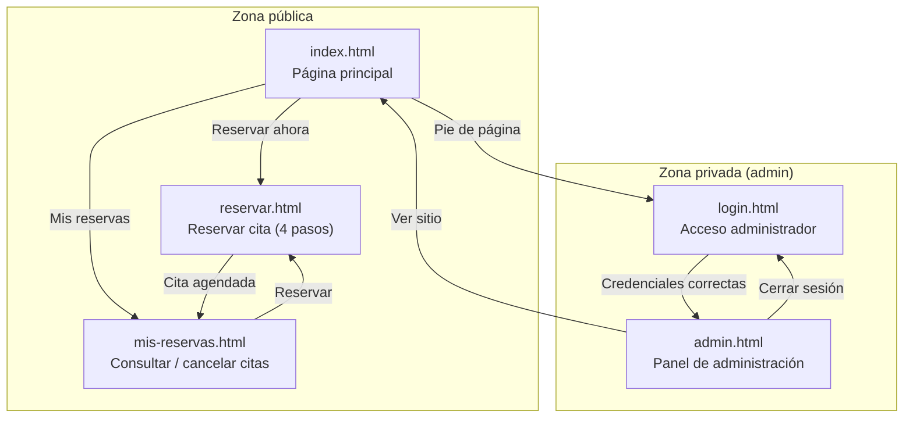
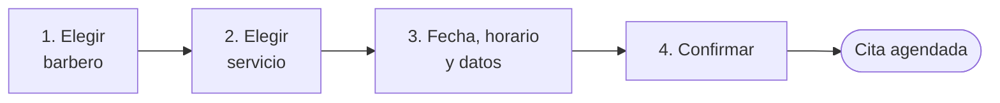

# Planeación del diseño — BarberCo

Borrador de la estructura del sitio hecho **antes** de programar: mapa del sitio, flujo de reservación,
wireframes (bocetos de baja fidelidad) y guía de estilo. Los diagramas se ven directamente en GitHub.

---

## 1. Mapa del sitio



### Secciones de la página principal

`Hero` → `Servicios` → `Nuestros barberos` → `Horarios y contacto` → `Llamado a la acción` → `Pie de página`

---

## 2. Flujo de reservación



Datos que pide el paso 3: fecha, horario disponible, nombre completo, teléfono, correo y notas (opcional).

---

## 3. Wireframes

Bocetos de baja fidelidad (escritorio). En móvil las columnas se apilan y el menú pasa a hamburguesa.

### 3.1 Página principal (`index.html`)

```
┌──────────────────────────────────────────────────────────┐
│ BarberCo        Servicios Barberos Horarios Mis reservas │
│                                         [Reservar ahora] │
├──────────────────────────────────────────────────────────┤
│  HERO                                                    │
│  ┌────────────────────────┐  ┌────────────────────────┐  │
│  │ Barbería de precisión  │  │                        │  │
│  │ CORTES QUE …           │  │   imagen / decoración  │  │
│  │ subtítulo              │  │                        │  │
│  │ [Reservar cita]        │  └────────────────────────┘  │
│  └────────────────────────┘                              │
├──────────────────────────────────────────────────────────┤
│  SERVICIOS                                               │
│  ┌────────┐ ┌────────┐ ┌────────┐ ┌────────┐ ┌────────┐  │
│  │nombre  │ │nombre  │ │nombre  │ │nombre  │ │nombre  │  │
│  │precio  │ │precio  │ │precio  │ │precio  │ │precio  │  │
│  └────────┘ └────────┘ └────────┘ └────────┘ └────────┘  │
├──────────────────────────────────────────────────────────┤
│  NUESTROS BARBEROS                                       │
│  ┌────────┐ ┌────────┐ ┌────────┐ ┌────────┐             │
│  │ foto   │ │ foto   │ │ foto   │ │ foto   │             │
│  │ nombre │ │ nombre │ │ nombre │ │ nombre │             │
│  │ espec. │ │ espec. │ │ espec. │ │ espec. │             │
│  └────────┘ └────────┘ └────────┘ └────────┘             │
├──────────────────────────────────────────────────────────┤
│  HORARIOS Y CONTACTO                                     │
│  [ Horario ]     [ Ubicación ]     [ Contacto ]          │
├──────────────────────────────────────────────────────────┤
│  AGENDA TU CITA HOY            [Reservar ahora →]        │
├──────────────────────────────────────────────────────────┤
│  Pie de página · Acceso administrador                    │
└──────────────────────────────────────────────────────────┘
```

### 3.2 Reservar cita (`reservar.html`)

```
┌──────────────────────────────────────────────────────────┐
│ BarberCo                          Servicios … [Reservar] │
├──────────────────────────────────────────────────────────┤
│        (1)────(2)────(3)────(4)        ← indicador       │
│       Barbero Servicio Fecha  Confirmar   de pasos       │
│                                                          │
│  ELIGE TU BARBERO            (cambia según el paso)      │
│  ┌──────────┐ ┌──────────┐ ┌──────────┐ ┌──────────┐     │
│  │  foto    │ │  foto    │ │  foto    │ │  foto    │     │
│  │  nombre  │ │  nombre  │ │  nombre  │ │  nombre  │     │
│  └──────────┘ └──────────┘ └──────────┘ └──────────┘     │
│                                                          │
│  Paso 3:  Fecha [ __/__/____ ]                           │
│           Horarios: [10:00] [10:30] [11:00] …            │
│           Nombre [____]  Teléfono [____]                 │
│           Correo [____]  Notas    [____]                 │
│                                                          │
│  [← Atrás]                              [Siguiente →]    │
└──────────────────────────────────────────────────────────┘
   Al terminar: pantalla "¡Cita agendada!" con el resumen.
```

### 3.3 Mis reservas (`mis-reservas.html`)

```
┌──────────────────────────────────────────────────────────┐
│ BarberCo                          Servicios … [Reservar] │
├──────────────────────────────────────────────────────────┤
│  MIS RESERVAS                                            │
│  Correo [______________________]  [Buscar]               │
│                                                          │
│  ( Todas )(Pendientes)(Confirmadas)(Completadas)(Canc.)  │
│  ┌────────────────────────────────────────────────────┐  │
│  │ Servicio · Barbero · Fecha y hora · Estado         │  │
│  │                                      [Cancelar]    │  │
│  └────────────────────────────────────────────────────┘  │
│  … más tarjetas de citas …                               │
│                                                          │
│  Modal al cancelar: [No, volver]  [Sí, cancelar]         │
└──────────────────────────────────────────────────────────┘
```

### 3.4 Login (`login.html`)

```
┌──────────────────────────────────────────┐
│                                          │
│              BARBERCO                    │
│          Acceso administrador            │
│                                          │
│      Correo      [__________________]    │
│      Contraseña  [__________________]    │
│                                          │
│            [   Entrar   ]                │
│                                          │
│          ← Volver al sitio               │
└──────────────────────────────────────────┘
```

### 3.5 Panel admin (`admin.html`)

```
┌────────────┬─────────────────────────────────────────────┐
│ BarberCo   │ Agenda del día                    (topbar)  │
│ PANEL ADMIN├─────────────────────────────────────────────┤
│            │ ┌───────┐ ┌───────┐ ┌───────┐ ┌───────┐     │
│ ▸ Agenda   │ │ Citas │ │Pendi- │ │Comple-│ │Ingre- │     │
│   del día  │ │ del   │ │entes  │ │tadas  │ │sos    │     │
│ ▸ Reserva- │ │ día   │ │       │ │       │ │       │     │
│   ciones   │ └───────┘ └───────┘ └───────┘ └───────┘     │
│ ▸ Gestión  │  [‹] fecha [›] [Hoy]  [Todos los barberos ▾]│
│            │ ┌─────────────────────────────────────────┐ │
│            │ │Hora│Cliente│Servicio│Barbero│Estado│Acc. │ │
│ ← Ver sitio│ └─────────────────────────────────────────┘ │
│ Cerrar     │                                             │
│ sesión     │  Reservaciones: tabla con filtros por       │
│            │    estado y barbero                         │
│            │  Gestión: Barberos · Servicios              │
│            │    (activar, desactivar, agregar)           │
└────────────┴─────────────────────────────────────────────┘
```

---

## 4. Guía de estilo

**Concepto:** barbería moderna y elegante — fondo oscuro con detalles dorados.

| Elemento | Valor |
|---|---|
| Fondo | `#0d0d0d` |
| Superficie / tarjetas | `#161616` / `#1c1c1c` |
| Dorado (acento principal) | `#c9a84c` |
| Dorado tenue | `#8a6e2f` |
| Crema (texto) | `#f0ead8` |
| Gris (texto secundario) | `#8a8a8a` |
| Verde (éxito) | `#2d6a4f` |

| Tipografía | Uso |
|---|---|
| **Bebas Neue** | Títulos y logo |
| **DM Sans** | Texto general y formularios |

Todos los valores viven como variables en `css/base.css` (`:root`), así que se cambian en un solo lugar.

**Componentes compartidos:** barra de navegación, botones (`btn-primary`, `btn-ghost`, `btn-danger`),
tarjetas y modal de confirmación.

**Responsivo:** menú hamburguesa y columnas apiladas en móvil; panel admin adaptable.
